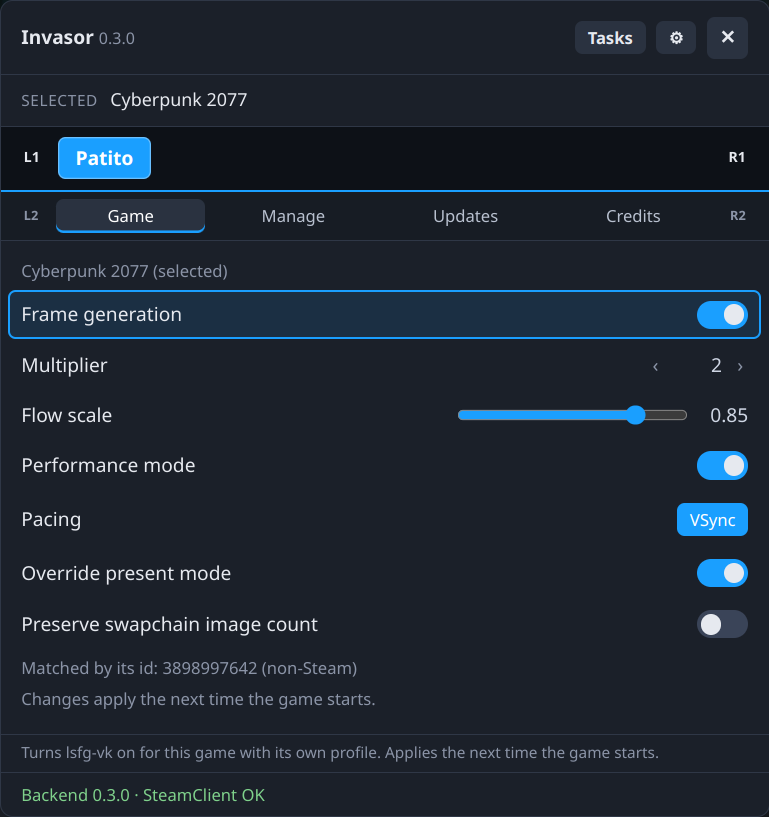
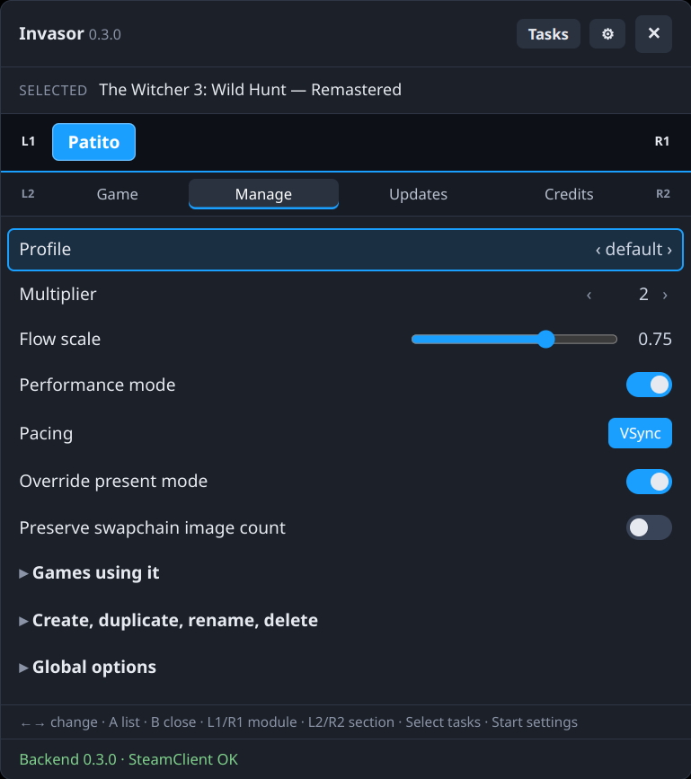
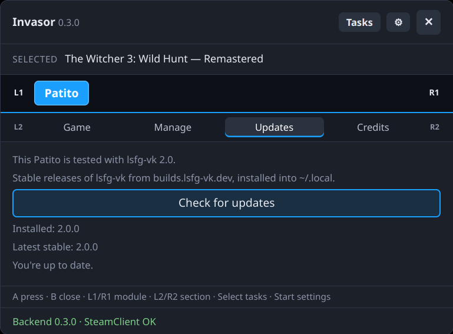

# Patito

A module for [Invasor](../invasor) that sets up **lsfg-vk** frame generation per game, from Steam's gamepad UI.

- **Game:** one switch for the game you're on. When it's on, the game gets its own lsfg-vk profile, named after it with its id in `active_in`, and all its options show below it. In Quick Access the tab only appears while the running game has an lsfg-vk profile; to give a game its first one, use the library's panel.
- **Manage:** every profile (edit, create, duplicate, rename, delete) and lsfg-vk's global options.
- **Updates:** checks builds.lsfg-vk.dev for the latest stable lsfg-vk and installs it into `~/.local`. The installed version is read from lsfg-vk's own library, so it's right however lsfg-vk was installed. A newer (git) build or a system install is never replaced. builds.lsfg-vk.dev publishes no checksums, so Invasor asks you before each download (a dialog in the panel, and in the Tasks panel); the progress shows as a task.

lsfg-vk's own `~/.config/lsfg-vk/conf.toml` is the only place where settings are kept. Patito reads and writes it without losing anything, and keeps a backup (`conf.toml.invasor-backup`) the first time it changes it. Every change is checked by lsfg-vk itself (`lsfg-vk-cli validate`) before it replaces the file, when lsfg-vk-cli is available.

## Screenshots

<p align="center">
  
  
  
</p>

## Requirements
- Invasor 0.3.0 or newer (`min_core`): updates are downloaded with `ctx.http` and unpacked with `ctx.archive`.
- [lsfg-vk](https://lsfg-vk.dev) 2.x installed (tested with 2.0.x), and your own copy of Lossless Scaling. Newer 2.x releases work, though options they add may not show in Patito; a new major version needs a newer Patito.

## Build, test and install
With the core checked out next to this repository (`../invasor`):

```sh
python3 ../invasor/tools/pack_module.py patito       # build, check, tests -> patito-<version>.zip
python3 ../invasor/tools/install_module.py patito    # or install that zip from ⚙ Settings › Install module
```

Tests on their own: `INVASOR_CORE=../invasor python3 -m unittest discover -s patito`.

## Credits
lsfg-vk is by PancakeTAS and its contributors; Lossless Scaling and its frame generation belong to their developers. Patito is not affiliated with either project. Please don't report problems with this module to them.

## License
[GNU General Public License v3.0 or later](LICENSE) (GPL-3.0-or-later).
